<picture><source media="(prefers-color-scheme: dark)" srcset="assets/dark/header.svg"/></picture>

<a href="https://saish.xyz"><picture><source media="(prefers-color-scheme: dark)" srcset="https://img.shields.io/badge/PORTFOLIO-0d1117?style=flat-square&logo=googlechrome&logoColor=ffffff"/></picture></a>
<a href="https://www.linkedin.com/in/saish-korgaonkar/"><picture><source media="(prefers-color-scheme: dark)" srcset="https://img.shields.io/badge/LINKEDIN-0d1117?style=flat-square&logoColor=ffffff"/></picture></a>
<a href="https://x.com/saishh_k"><picture><source media="(prefers-color-scheme: dark)" srcset="https://img.shields.io/badge/X-0d1117?style=flat-square&logo=x&logoColor=ffffff"/></picture></a>
<a href="mailto:contact@saish.xyz"><picture><source media="(prefers-color-scheme: dark)" srcset="https://img.shields.io/badge/EMAIL-0d1117?style=flat-square&logo=maildotru&logoColor=ffffff"/></picture></a>
<a href="https://codepulse.saish.xyz/activity"><picture><source media="(prefers-color-scheme: dark)" srcset="https://img.shields.io/badge/LIVE_ACTIVITY-0d1117?style=flat-square&logo=githubactions&logoColor=ffffff"/></picture></a>

<picture><source media="(prefers-color-scheme: dark)" srcset="assets/dark/s01.svg"/></picture>
<picture><source media="(prefers-color-scheme: dark)" srcset="assets/dark/whoami.svg"/></picture>
<picture><source media="(prefers-color-scheme: dark)" srcset="assets/dark/s02.svg"/></picture>
<picture><source media="(prefers-color-scheme: dark)" srcset="assets/dark/experience.svg"/></picture>
<picture><source media="(prefers-color-scheme: dark)" srcset="assets/dark/s03.svg"/></picture>
<picture><source media="(prefers-color-scheme: dark)" srcset="assets/dark/wins.svg"/></picture>
<picture><source media="(prefers-color-scheme: dark)" srcset="assets/dark/s04.svg"/></picture>
<picture><source media="(prefers-color-scheme: dark)" srcset="assets/dark/community.svg"/></picture>
<picture><source media="(prefers-color-scheme: dark)" srcset="assets/dark/s05.svg"/></picture>
<picture><source media="(prefers-color-scheme: dark)" srcset="assets/dark/stack.svg"/></picture>
<picture><source media="(prefers-color-scheme: dark)" srcset="assets/dark/s06.svg"/></picture>

<picture><source media="(prefers-color-scheme: dark)" srcset="https://github-readme-stats-beta-snowy-84.vercel.app/api?username=SaishKorgaonkar&show_icons=true&include_all_commits=true&count_private=true&bg_color=00000000&hide_border=true&title_color=F0A35E&text_color=9198A1&icon_color=F0A35E"/></picture>
<picture><source media="(prefers-color-scheme: dark)" srcset="https://github-readme-stats-beta-snowy-84.vercel.app/api/top-langs/?username=SaishKorgaonkar&layout=compact&langs_count=8&bg_color=00000000&hide_border=true&title_color=F0A35E&text_color=9198A1&icon_color=F0A35E"/></picture>

<picture><source media="(prefers-color-scheme: dark)" srcset="https://streak-stats.demolab.com?user=SaishKorgaonkar&hide_border=true&background=00000000&ring=F0A35E&fire=F0A35E&currStreakNum=E6EDF3&sideNums=E6EDF3&currStreakLabel=F0A35E&sideLabels=9198A1&dates=9198A1&stroke=30363D"/></picture>

<picture><source media="(prefers-color-scheme: dark)" srcset="assets/dark/footer.svg"/></picture>
